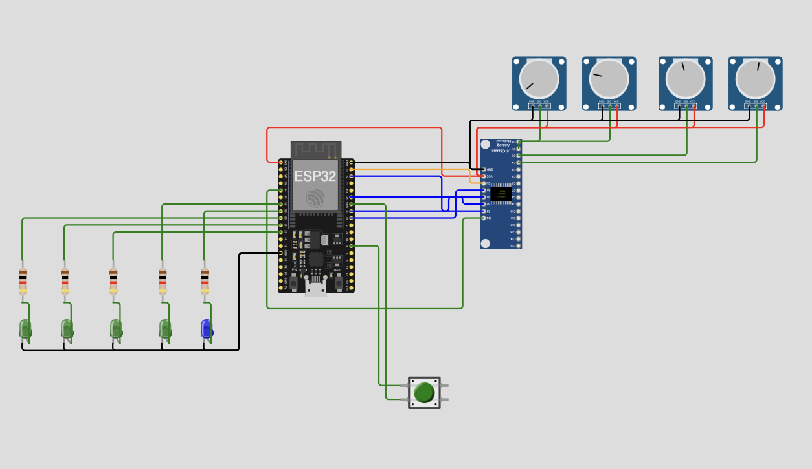
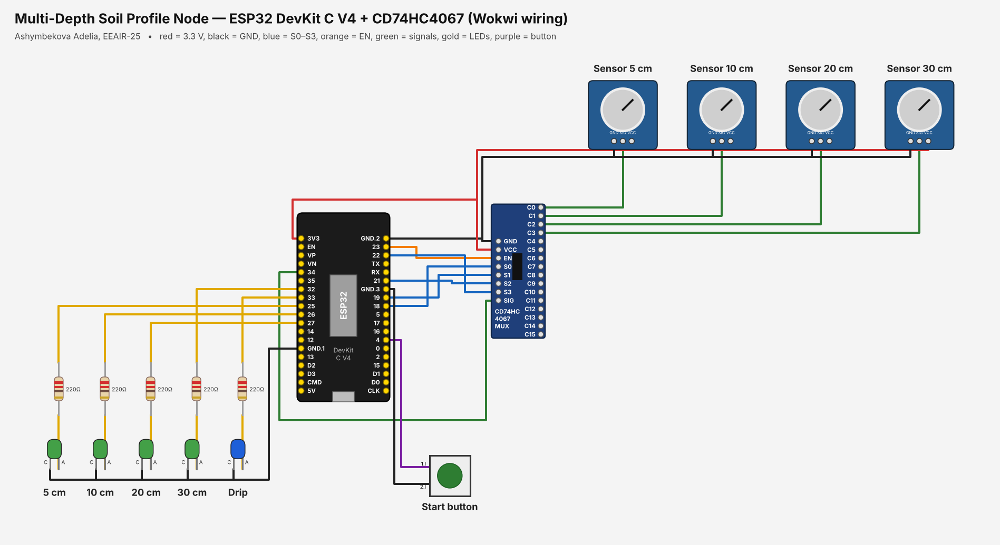
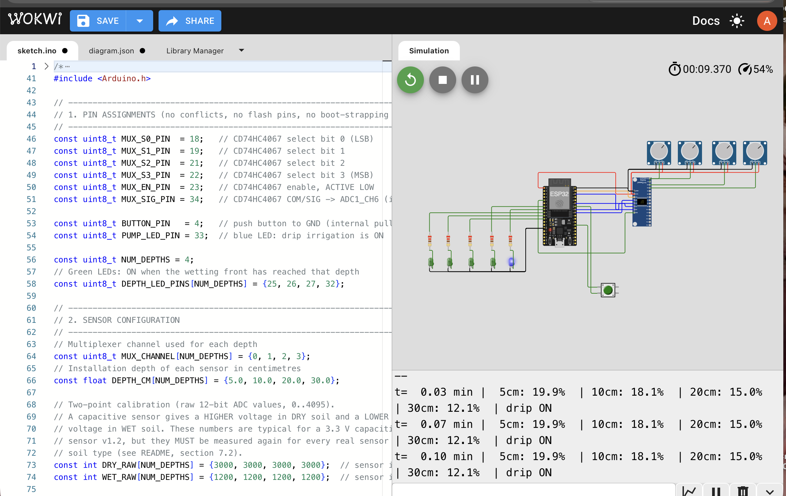

# Multi-Depth Soil Profile Node: Measuring Soil Moisture at Multiple Depths

| | |
|---|---|
| **Title** | Multi-Depth Soil Profile Node: Measuring Soil Moisture at Multiple Depths |
| **Name** | Ashymbekova Adelia, group EEAIR-25 |
| **Supervisor** | Tauheed Khan |
| **Application** | Smart drip irrigation: the node shows how deep the water goes in the soil and stops watering when the water reaches the plant roots (30 cm) |
| **Subject** | Electronics Component and Circuit |
| **Platform** | ESP32 DevKit C V4 + CD74HC4067 multiplexer, simulated in Wokwi |
| **Links** | GitHub: _[repository link]_ · Google Drive (video / files): _[Drive link]_ · Wokwi: _[project link]_ |

---

## Contents

1. [Introduction](#1-introduction)
2. [Methods](#2-methods)
3. [Results](#3-results)
4. [5-Minute Presentation Plan](#4-5-minute-presentation-plan)
5. [References](#5-references)
6. [Appendix A: Source Code (`sketch.ino`)](#appendix-a-source-code-sketchino)
7. [Appendix B: Circuit File (`diagram.json`)](#appendix-b-circuit-file-diagramjson)

---

## 1. Introduction

### 1.1 Background

When a drip emitter waters the soil, the water does not wet all the soil at once. It moves down layer by layer. The moving border between wet soil and dry soil is called the **wetting front**.

In Kyrgyzstan and Central Asia, agriculture uses most of the fresh water. Drip irrigation saves water, but farmers usually do not know **how deep** the water goes. If the water goes deeper than the plant roots (about 30 cm for vegetables), the water and the fertiliser in it are lost.

One moisture sensor shows only one soil layer. To see how water moves, we need several sensors at different depths. But every analog sensor needs an ADC input, and a microcontroller has only a few good ADC pins. A **multiplexer** solves this problem: it works like a rotary switch that connects one of 16 inputs to one output.

### 1.2 Research question

> **Can an array of multiplexed capacitive soil moisture sensors track the speed and direction of a wetting front during drip irrigation?**

### 1.3 Objectives

1. Connect 4 soil moisture sensors (5, 10, 20 and 30 cm) to **one** ESP32 ADC pin through a CD74HC4067 multiplexer.
2. Use only safe **3.3 V** levels and a common ground.
3. Convert raw ADC values (0–4095) to soil moisture (0–100 %).
4. Record the moisture at all depths every 2 seconds.
5. Detect when the wetting front reaches each depth and calculate its **speed**, the **first wet depth** and the **direction**.
6. Show the result with LEDs and the Serial Monitor, and stop the drip when water reaches 30 cm.
7. Build and test the whole system in the Wokwi simulator.

---

## 2. Methods

### 2.1 Components

| # | Component | Qty | Role in the project |
|---|---|---|---|
| 1 | ESP32 DevKit C V4 | 1 | Main controller: reads sensors, calculates speed, controls LEDs |
| 2 | CD74HC4067 16-channel analog multiplexer | 1 | Connects one of the 4 sensors to the ESP32 ADC at a time |
| 3 | Potentiometer (in Wokwi) = capacitive soil moisture sensor (real) | 4 | Moisture at 5, 10, 20 and 30 cm |
| 4 | Green LED + 220 Ω resistor | 4 | "Water reached this depth" |
| 5 | Blue LED + 220 Ω resistor | 1 | "Drip irrigation is ON" (pump / valve) |
| 6 | Push button | 1 | Starts a new irrigation event |

**Main specifications**

| Part | Key data |
|---|---|
| ESP32 DevKit C V4 | Dual-core 240 MHz, 3.3 V logic, 12-bit ADC (0–4095), Wi-Fi + Bluetooth |
| CD74HC4067 | 16 inputs (C0–C15) → 1 output (SIG); select pins S0–S3; EN is active LOW; supply 2–6 V |
| Capacitive sensor v1.2 | About 2.5 V in dry soil, about 1.2 V in water (lower voltage = wetter); no corrosion |
| Potentiometer | Gives 0–3.3 V, like a sensor. Turn **left = wetter**, right = drier |
| LED + 220 Ω | Current ≈ (3.3 − 2.0) V / 220 Ω ≈ 5.9 mA — safe for an ESP32 pin |

**Why potentiometers?** Wokwi has no soil moisture sensor, so each sensor is simulated by a potentiometer. It gives the same kind of analog voltage, but it does not simulate real soil physics or sensor noise.

### 2.2 The circuit in Wokwi

This is my circuit, built in the Wokwi simulator:



**Explanation of the screenshot**

* **ESP32 (in the middle)** – the black board is the "brain" of the project. All wires start or end here.
* **Four potentiometers (top right)** – they play the role of the four soil moisture sensors. From left to right they are the sensors at **5 cm, 10 cm, 20 cm and 30 cm**. Each one has three pins: GND, SIG and VCC. The red wire is the 3.3 V power, the black wire is ground (GND), and the green wire carries the signal.
* **Multiplexer (blue board on the right)** – the four green signal wires from the potentiometers go to its channels **C0, C1, C2 and C3**. On the other side of the board, four **blue wires** (S0–S3) and one **orange wire** (EN) come from the ESP32. With these wires the ESP32 chooses which sensor is connected. The selected sensor's voltage goes out of the **SIG** pin through a green wire to **GPIO34** of the ESP32. The board is rotated by 180°, so the text on it is upside down, but the connections are correct.
* **Red and black wires at the top** – they bring 3.3 V and GND from the ESP32 to the multiplexer and to all four potentiometers. All parts share a **common ground**.
* **Resistors and LEDs (left)** – five wires from the ESP32 (GPIO 25, 26, 27, 32 and 33) go through **220 Ω resistors** to the LEDs. The four **green LEDs** turn on when the water reaches 5, 10, 20 and 30 cm. The **blue LED** shows that the drip irrigation is ON. The black wire under the LEDs connects all LED cathodes to GND.
* **Push button (bottom)** – one wire goes to **GPIO4**, the other goes to **GND**. Pressing the button starts a new irrigation event.

So the signal path is: **potentiometer (sensor) → multiplexer channel → SIG → ESP32 GPIO34 → program → LEDs and Serial Monitor.**

**Wiring diagram with all pin names** (the same connections, drawn with labels; in my Wokwi file each potentiometer is wired directly to the multiplexer VCC and GND):



### 2.3 Pin connection table

| Component | Component pin | ESP32 pin |
|---|---|---|
| Multiplexer | VCC / GND | 3V3 / GND |
| Multiplexer | S0 / S1 / S2 / S3 | 18 / 19 / 21 / 22 |
| Multiplexer | EN | 23 |
| Multiplexer | SIG | 34 (ADC1) |
| Sensors 5 / 10 / 20 / 30 cm | SIG | multiplexer C0 / C1 / C2 / C3 |
| Sensors | VCC / GND | 3V3 / GND |
| Green LEDs 5 / 10 / 20 / 30 cm | anode via 220 Ω | 25 / 26 / 27 / 32 |
| Blue LED (drip) | anode via 220 Ω | 33 |
| Push button | two pins | 4 / GND |

Multiplexer channel selection:

| S3 | S2 | S1 | S0 | Channel | Sensor |
|---|---|---|---|---|---|
| 0 | 0 | 0 | 0 | C0 | 5 cm |
| 0 | 0 | 0 | 1 | C1 | 10 cm |
| 0 | 0 | 1 | 0 | C2 | 20 cm |
| 0 | 0 | 1 | 1 | C3 | 30 cm |

### 2.4 How the system works

1. **Start:** all LEDs flash once. The program measures the starting ("dry") moisture of each depth — the **baseline**. The blue LED turns on (drip ON).
2. **Every 2 seconds** the ESP32 selects channel 0, 1, 2 and 3 one after another, reads each sensor on GPIO34 (16 readings averaged) and converts the value to moisture %.
3. **Front detection:** when the moisture at a depth becomes **20 points higher than its baseline**, the program says "the water has arrived here", saves the time and turns on that green LED.
4. **Speed and direction:** the program calculates the speed between two depths and checks the order in which the depths became wet.
5. **Stop:** when the 30 cm sensor becomes wet, the blue LED turns off (drip OFF), and a final report is printed.

### 2.5 Formulas

| What | Formula | Example |
|---|---|---|
| ADC → voltage | V = raw × 3.3 / 4095 | raw 2010 → 1.62 V |
| Moisture | M = (DRY − raw) / (DRY − WET) × 100 | DRY = 3000, WET = 1200, raw 2010 → **55 %** |
| Arrival threshold | M_thr = M_baseline + 20 | 20 % → 40 % |
| Arrival time (interpolation) | t* = t₁ + (M_thr − M₁)/(M₂ − M₁) × (t₂ − t₁) | 0 + (40−20)/(55−20) × 2 = **1.14 min** |
| Front speed | V = Δd / Δt | 10 cm / 2.06 min = **4.86 cm/min** |
| Average speed (all sensors) | V_fit = Σ(t−t̄)(d−d̄) / Σ(t−t̄)² | **4.11 cm/min** |

*Note: DRY and WET are typical values. A real sensor must be calibrated in dry and wet soil of the same type.*

### 2.6 Software

* Language: C++ (Arduino core for ESP32). **No external libraries.**
* Main functions: `selectMuxChannel()`, `readMuxChannelRaw()`, `rawToMoisturePercent()`, `detectWettingFront()`, `regressionSpeed()`, `frontDirection()`, `printFinalReport()`.
* Non-blocking timing with `millis()`, so the button and serial commands always work.
* Serial commands: `s` = new event, `r` = report, `c` = CSV data for Excel, `h` = help.
* The code compiles with **0 errors and 0 warnings** (21 % of flash, 7 % of RAM).

### 2.7 How to run it in Wokwi

1. Open wokwi.com → **ESP32** → new project.
2. Paste Appendix A into **sketch.ino** and Appendix B into **diagram.json**.
3. Press the green **▶** button. The Serial Monitor opens under the circuit.
4. Turn the knobs to the **left** one after another: 5 cm, then 10, 20 and 30 cm.

---

## 3. Results

### 3.1 Results in the Wokwi simulation

**Before irrigation (start of the simulation):**



All four sensors are dry: 5 cm = 19.9 %, 10 cm = 18.1 %, 20 cm = 15.0 %, 30 cm = 12.1 %. Each sensor shows a different value, so the multiplexer reads every channel separately. The blue LED is on and the Serial Monitor shows `drip ON` — the drip irrigation is working. The green LEDs are off because the water has not reached any depth yet.

**After irrigation (all knobs turned to "wet"):**


I turned the knobs to the left one by one (5 → 10 → 20 → 30 cm), like water moving down into the soil. Now all four green LEDs are on, and every depth has the letter `W` (the wetting front has passed). When the water reached the deepest sensor (30 cm), the program switched the drip off automatically: the blue LED is off and the Serial Monitor shows `drip OFF`. This is exactly what a smart irrigation system should do — stop watering when the water reaches the plant roots.

**Summary of the simulation test:**

* The circuit runs in Wokwi without errors.
* At start the program printed a **different baseline for each sensor: 19.9 %, 18.1 %, 15.0 % and 12.1 %**. This shows that the multiplexer switches correctly and every sensor is read separately.
* When a knob is turned to the left, the moisture of that depth rises, the program prints `WETTING FRONT reached … cm` and the green LED of that depth turns on.
* When the 30 cm sensor becomes wet, the blue LED turns off and the final report is printed.

### 3.2 Test with demonstration data

To check the calculations, the program was tested with these demonstration values (illustrative values, **not real field measurements**):

| Time | 5 cm | 10 cm | 20 cm | 30 cm |
|---|---|---|---|---|
| 0 min | 20 % | 18 % | 15 % | 12 % |
| 2 min | 55 % | 20 % | 16 % | 12 % |
| 4 min | 70 % | 50 % | 18 % | 13 % |
| 6 min | 75 % | 65 % | 45 % | 15 % |
| 8 min | 78 % | 70 % | 60 % | 40 % |

Program output:

```
################ WETTING FRONT REPORT ################
Depth | Baseline | Peak   | Arrival time | Order
  5cm |   20.0%  |  77.1% |     1.14 min | 1
 10cm |   18.0%  |  68.4% |     3.20 min | 2
 20cm |   15.0%  |  55.2% |     5.26 min | 3
 30cm |   12.0%  |  32.1% |     7.36 min | 4
First depth to become wet: 5 cm
Direction of movement   : DOWNWARD (infiltration from the surface dripper)
Segment speeds (V = delta_d / delta_t):
   5 -> 10 cm : 5 cm / 2.06 min = 2.43 cm/min
  10 -> 20 cm : 10 cm / 2.06 min = 4.86 cm/min
  20 -> 30 cm : 10 cm / 2.10 min = 4.75 cm/min
Average speed  5 -> 30 cm   : 4.02 cm/min
Best-fit speed (regression): 4.11 cm/min
######################################################
```

I also calculated these numbers by hand with the formulas in Section 2.5, and they are the same as the program output.

### 3.3 Answer to the research question

* **Direction – yes.** The order in which the sensors become wet shows the direction (5 → 10 → 20 → 30 cm = downward).
* **Speed – yes, with limits.** V = Δd / Δt gives the speed between sensors; in the demo the average speed was about **4 cm/min**.
* **The multiplexer is fast enough.** Switching a channel takes less than 1 ms, but water needs minutes to move between sensors.
* **Limits:** sensor spacing (we only know the front is between two sensors), sampling time, sensor calibration and the soil itself (cracks and roots).

### 3.4 Limitations

* Sensors are simulated with potentiometers, so there is no real soil and no sensor noise.
* Calibration values are typical values, not measured in real soil.
* In the simulation the knobs are turned by hand, so the speeds are faster than in a real field.

### 3.5 Applications

1. **Smart drip irrigation** – stop watering when the water reaches the roots; this saves water, electricity and fertiliser.
2. **Greenhouses and orchards** in Kyrgyzstan – choose the right watering time for each crop and soil.
3. **Irrigation check** – a sudden change in front speed can show a blocked dripper or cracked soil.
4. **Protecting groundwater** – less fertiliser is washed below the roots.
5. **Education and soil research** – show how fast water enters sand, loam or clay.

### 3.6 Conclusion

A multi-depth soil moisture node was designed and tested in Wokwi. The ESP32 reads four sensors at 5, 10, 20 and 30 cm through one CD74HC4067 multiplexer and one ADC pin. It finds the first wet depth, the direction and the speed of the wetting front, and it stops the drip when the water reaches 30 cm. The results show that the answer to the research question is **yes**. The next step is to build the real prototype with capacitive sensors and test it in real soil.

---

## 4. 5-Minute Presentation Plan

| Time | Part | What to show |
|---|---|---|
| 0:00–0:30 | Title | Title, my name, supervisor, application |
| 0:30–1:30 | Introduction | Problem (water loss in irrigation), wetting front, research question |
| 1:30–3:00 | Methods | Components, Wokwi circuit screenshot, how the multiplexer works, formula V = Δd / Δt |
| 3:00–4:30 | Results | Live Wokwi demo: turn knobs 5 → 30 cm, LEDs turn on, final report; answer to the research question |
| 4:30–5:00 | Conclusion | Applications and next steps |

---

## 5. References

1. Texas Instruments. *CD74HC4067 High-Speed CMOS 16-Channel Analog Multiplexer — Datasheet.* https://www.ti.com/product/CD74HC4067
2. Espressif Systems. *ESP32 Series Datasheet.*
3. Wokwi documentation. https://docs.wokwi.com
4. Hillel, D. (2004). *Introduction to Environmental Soil Physics.* Elsevier Academic Press.
5. Green, W. H., Ampt, G. A. (1911). Studies on soil physics: Flow of air and water through soils. *Journal of Agricultural Science*, 4, 1–24.

---

## Appendix A: Source Code (`sketch.ino`)

```cpp
/*
 * ============================================================================
 *  Multi-Depth Soil Profile Node
 *  Measuring soil moisture at 5, 10, 20 and 30 cm and tracking the
 *  wetting front during drip irrigation.
 * ============================================================================
 *
 *  Student    : Ashymbekova Adelia        Group : EEAIR-25
 *  Subject    : Electronics Component and Circuit
 *
 *  Board      : ESP32 DevKit C V4 (Wokwi part: board-esp32-devkit-c-v4)
 *  Multiplexer: CD74HC4067 16-channel analog multiplexer (Wokwi part: board-cd74hc4067)
 *  Sensors    : 4 x capacitive soil moisture sensors
 *               -> in Wokwi they are simulated with 4 potentiometers
 *
 *  Research question:
 *    Can an array of multiplexed capacitive soil moisture sensors track the
 *    speed and direction of a wetting front during drip irrigation?
 *
 *  What the program does:
 *    1. Selects one sensor at a time with the CD74HC4067 (pins S0..S3).
 *    2. Reads the analog voltage on the ESP32 ADC (GPIO34).
 *    3. Converts the raw ADC value into soil moisture (%) with a
 *       two-point calibration (dry value and wet value).
 *    4. Logs a time series every SAMPLE_INTERVAL_MS.
 *    5. Detects when the wetting front reaches each depth
 *       (moisture rises RISE_THRESHOLD points above its baseline).
 *    6. Calculates the wetting front speed V = delta_d / delta_t.
 *    7. Reports which depth became wet first and the direction of movement.
 *    8. Compares moisture changes over time (change since start + rate).
 *
 *  Controls:
 *    - Green push button (GPIO4) : start a new irrigation event
 *    - Serial Monitor commands   : s = start new event, r = report,
 *                                  c = toggle CSV output, h = help
 *
 *  No external libraries are needed (only the ESP32 Arduino core).
 * ============================================================================
 */

#include <Arduino.h>

// ---------------------------------------------------------------------------
// 1. PIN ASSIGNMENTS (no conflicts, no flash pins, no boot-strapping inputs)
// ---------------------------------------------------------------------------
const uint8_t MUX_S0_PIN  = 18;   // CD74HC4067 select bit 0 (LSB)
const uint8_t MUX_S1_PIN  = 19;   // CD74HC4067 select bit 1
const uint8_t MUX_S2_PIN  = 21;   // CD74HC4067 select bit 2
const uint8_t MUX_S3_PIN  = 22;   // CD74HC4067 select bit 3 (MSB)
const uint8_t MUX_EN_PIN  = 23;   // CD74HC4067 enable, ACTIVE LOW
const uint8_t MUX_SIG_PIN = 34;   // CD74HC4067 COM/SIG -> ADC1_CH6 (input only)

const uint8_t BUTTON_PIN   = 4;   // push button to GND (internal pull-up)
const uint8_t PUMP_LED_PIN = 33;  // blue LED: drip irrigation is ON

const uint8_t NUM_DEPTHS = 4;
// Green LEDs: ON when the wetting front has reached that depth
const uint8_t DEPTH_LED_PINS[NUM_DEPTHS] = {25, 26, 27, 32};

// ---------------------------------------------------------------------------
// 2. SENSOR CONFIGURATION
// ---------------------------------------------------------------------------
// Multiplexer channel used for each depth
const uint8_t MUX_CHANNEL[NUM_DEPTHS] = {0, 1, 2, 3};
// Installation depth of each sensor in centimetres
const float DEPTH_CM[NUM_DEPTHS] = {5.0, 10.0, 20.0, 30.0};

// Two-point calibration (raw 12-bit ADC values, 0..4095).
// A capacitive sensor gives a HIGHER voltage in DRY soil and a LOWER
// voltage in WET soil. These numbers are typical for a 3.3 V capacitive
// sensor v1.2, but they MUST be measured again for every real sensor and
// soil type (see README, section 7.2).
const int DRY_RAW[NUM_DEPTHS] = {3000, 3000, 3000, 3000};  // sensor in dry soil / air
const int WET_RAW[NUM_DEPTHS] = {1200, 1200, 1200, 1200};  // sensor in saturated soil / water

// ---------------------------------------------------------------------------
// 3. MEASUREMENT AND ANALYSIS SETTINGS
// ---------------------------------------------------------------------------
const uint32_t SAMPLE_INTERVAL_MS = 2000;  // one reading of all depths every 2 s
const uint8_t  ADC_SAMPLES        = 16;    // readings averaged per channel (noise filter)
const uint16_t MUX_SETTLE_US      = 500;   // wait after switching channel
const float    RISE_THRESHOLD     = 20.0;  // % points above baseline = "front arrived"
const uint8_t  BASELINE_SAMPLES   = 5;     // readings averaged to get the baseline
const uint8_t  SUMMARY_EVERY      = 5;     // print comparison table every N samples

// TIME_SCALE lets a short simulation represent a longer field experiment.
// 1.0  -> times are real (1 s in Wokwi = 1 s in the field).
// 30.0 -> 1 s in Wokwi represents 30 s in the field (useful for a demo video).
const float TIME_SCALE = 1.0;

// Size of the time-series history kept in RAM
const uint8_t HISTORY_LEN = 60;

// ---------------------------------------------------------------------------
// 4. DATA STRUCTURES
// ---------------------------------------------------------------------------
struct DepthState {
  int   raw;            // last averaged ADC value
  float moisture;       // current moisture (%)
  float prevMoisture;   // moisture in previous sample (%)
  float baseline;       // moisture at the start of irrigation (%)
  float threshold;      // baseline + RISE_THRESHOLD (%)
  float peak;           // highest moisture during this event (%)
  float ratePerMin;     // change rate between last two samples (%/min)
  bool  frontArrived;   // true after the wetting front reached this depth
  float arrivalMin;     // arrival time in minutes after irrigation start
  int8_t arrivalOrder;  // 1 = first depth to get wet, 2 = second, ...
};

DepthState depth[NUM_DEPTHS];

// Ring buffer for the time series
float    historyMoisture[HISTORY_LEN][NUM_DEPTHS];
float    historyTimeMin[HISTORY_LEN];
uint8_t  historyHead  = 0;   // next position to write
uint8_t  historyCount = 0;   // how many valid entries

// Irrigation event state
uint32_t eventStartMs     = 0;
uint16_t eventNumber      = 0;
bool     irrigationOn     = false;
uint8_t  arrivalsCount    = 0;
bool     finalReportShown = false;

// Timing and user interface
uint32_t lastSampleMs  = 0;
uint32_t sampleCounter = 0;
float    lastSampleMin = 0.0;
bool     csvMode       = false;

// Button debouncing
bool     lastButtonReading = HIGH;
bool     buttonState       = HIGH;
uint32_t lastDebounceMs    = 0;

// Forward declarations (functions defined further below)
void printCsvHeader();
void printFinalReport();

// ---------------------------------------------------------------------------
// 5. MULTIPLEXER AND ADC FUNCTIONS
// ---------------------------------------------------------------------------

// Put a 4-bit channel number (0..15) on S0..S3
void selectMuxChannel(uint8_t channel) {
  digitalWrite(MUX_S0_PIN, (channel >> 0) & 0x01);
  digitalWrite(MUX_S1_PIN, (channel >> 1) & 0x01);
  digitalWrite(MUX_S2_PIN, (channel >> 2) & 0x01);
  digitalWrite(MUX_S3_PIN, (channel >> 3) & 0x01);
}

// Read one multiplexer channel and return the averaged raw ADC value
int readMuxChannelRaw(uint8_t channel) {
  digitalWrite(MUX_EN_PIN, HIGH);      // disable outputs while switching
  selectMuxChannel(channel);
  digitalWrite(MUX_EN_PIN, LOW);       // enable the selected channel
  delayMicroseconds(MUX_SETTLE_US);    // let the voltage settle

  analogRead(MUX_SIG_PIN);             // first reading is discarded

  uint32_t sum = 0;
  for (uint8_t i = 0; i < ADC_SAMPLES; i++) {
    sum += analogRead(MUX_SIG_PIN);
    delayMicroseconds(100);
  }
  return (int)(sum / ADC_SAMPLES);
}

// Convert raw ADC value to soil moisture percentage (two-point calibration)
// Moisture(%) = (DRY - raw) / (DRY - WET) * 100, limited to 0..100 %
float rawToMoisturePercent(int raw, uint8_t i) {
  float percent = (float)(DRY_RAW[i] - raw) * 100.0 / (float)(DRY_RAW[i] - WET_RAW[i]);
  if (percent < 0.0)   percent = 0.0;
  if (percent > 100.0) percent = 100.0;
  return percent;
}

// Convert raw ADC value to volts (for information only)
float rawToVolts(int raw) {
  return raw * 3.3 / 4095.0;
}

// Read all four depths and update moisture values
void readAllDepths() {
  for (uint8_t i = 0; i < NUM_DEPTHS; i++) {
    depth[i].raw = readMuxChannelRaw(MUX_CHANNEL[i]);
    depth[i].prevMoisture = depth[i].moisture;
    depth[i].moisture = rawToMoisturePercent(depth[i].raw, i);
  }
}

// Minutes since the irrigation event started (scaled by TIME_SCALE)
float minutesSinceStart() {
  return (millis() - eventStartMs) / 60000.0 * TIME_SCALE;
}

// ---------------------------------------------------------------------------
// 6. IRRIGATION EVENT CONTROL
// ---------------------------------------------------------------------------

void updateLeds() {
  for (uint8_t i = 0; i < NUM_DEPTHS; i++) {
    digitalWrite(DEPTH_LED_PINS[i], depth[i].frontArrived ? HIGH : LOW);
  }
  digitalWrite(PUMP_LED_PIN, irrigationOn ? HIGH : LOW);
}

// Start a new irrigation event: measure baseline and reset the analysis
void startIrrigationEvent() {
  eventNumber++;
  Serial.println();
  Serial.println(F("============================================================"));
  Serial.printf("  IRRIGATION EVENT #%u STARTED - measuring baseline...\n", eventNumber);
  Serial.println(F("============================================================"));

  // Baseline = average of several readings taken before water arrives
  float sum[NUM_DEPTHS] = {0, 0, 0, 0};
  for (uint8_t n = 0; n < BASELINE_SAMPLES; n++) {
    for (uint8_t i = 0; i < NUM_DEPTHS; i++) {
      sum[i] += rawToMoisturePercent(readMuxChannelRaw(MUX_CHANNEL[i]), i);
    }
    delay(20);
  }

  for (uint8_t i = 0; i < NUM_DEPTHS; i++) {
    depth[i].baseline     = sum[i] / BASELINE_SAMPLES;
    depth[i].threshold    = depth[i].baseline + RISE_THRESHOLD;
    depth[i].moisture     = depth[i].baseline;
    depth[i].prevMoisture = depth[i].baseline;
    depth[i].peak         = depth[i].baseline;
    depth[i].ratePerMin   = 0.0;
    depth[i].frontArrived = false;
    depth[i].arrivalMin   = -1.0;
    depth[i].arrivalOrder = 0;

    Serial.printf("  Depth %4.0f cm : baseline = %5.1f %%  ->  threshold = %5.1f %%\n",
                  DEPTH_CM[i], depth[i].baseline, depth[i].threshold);
    if (depth[i].threshold > 100.0) {
      Serial.printf("  WARNING: %2.0f cm is already very wet, the front cannot be detected there.\n",
                    DEPTH_CM[i]);
    }
  }

  historyHead = 0;
  historyCount = 0;
  arrivalsCount = 0;
  finalReportShown = false;
  sampleCounter = 0;
  lastSampleMin = 0.0;
  irrigationOn = true;
  eventStartMs = millis();
  lastSampleMs = eventStartMs;
  updateLeds();

  Serial.println(F("  Drip irrigation is ON (blue LED)."));
  Serial.println(F("  In Wokwi: turn a knob to the LEFT (counter-clockwise) = wetter soil."));
  Serial.println(F("  Wet the 5 cm knob first, then 10, 20 and 30 cm to simulate infiltration."));
  Serial.println(F("------------------------------------------------------------"));
  if (csvMode) printCsvHeader();
}

// ---------------------------------------------------------------------------
// 7. WETTING FRONT ANALYSIS
// ---------------------------------------------------------------------------

// Check every depth for the moment its moisture crosses the threshold.
// Linear interpolation between two samples gives a more exact crossing time:
//   t_cross = t_prev + (threshold - m_prev) / (m_now - m_prev) * (t_now - t_prev)
void detectWettingFront(float nowMin) {
  for (uint8_t i = 0; i < NUM_DEPTHS; i++) {
    if (depth[i].frontArrived) continue;
    if (depth[i].threshold > 100.0) continue;
    if (depth[i].moisture < depth[i].threshold) continue;

    float mPrev = depth[i].prevMoisture;
    float mNow  = depth[i].moisture;
    float tCross = nowMin;
    if (mNow > mPrev && mPrev < depth[i].threshold) {
      tCross = lastSampleMin + (depth[i].threshold - mPrev) / (mNow - mPrev) * (nowMin - lastSampleMin);
    }

    depth[i].frontArrived = true;
    depth[i].arrivalMin   = tCross;
    arrivalsCount++;
    depth[i].arrivalOrder = arrivalsCount;

    Serial.println();
    Serial.printf(">>> WETTING FRONT reached %2.0f cm at t = %.2f min (arrival #%u)\n",
                  DEPTH_CM[i], tCross, arrivalsCount);

    if (arrivalsCount == 1) {
      Serial.printf(">>> FIRST WET DEPTH: %2.0f cm\n", DEPTH_CM[i]);
      if (tCross > 0.0) {
        // Dripper is at the surface (0 cm), so the first speed is d / t
        Serial.printf(">>> Speed from surface (0 cm) to %2.0f cm: %.2f cm/min\n",
                      DEPTH_CM[i], DEPTH_CM[i] / tCross);
      }
    } else {
      // Speed between this depth and the depth that got wet just before it
      int8_t prev = -1;
      for (uint8_t j = 0; j < NUM_DEPTHS; j++) {
        if (depth[j].arrivalOrder == arrivalsCount - 1) prev = j;
      }
      if (prev >= 0) {
        float dDepth = DEPTH_CM[i] - DEPTH_CM[prev];
        float dTime  = depth[i].arrivalMin - depth[prev].arrivalMin;
        const char *dir = (dDepth > 0) ? "DOWNWARD" : "UPWARD";
        if (dTime > 0.001) {
          Serial.printf(">>> Segment %2.0f -> %2.0f cm: delta_d = %.0f cm, delta_t = %.2f min, V = %.2f cm/min (%s)\n",
                        DEPTH_CM[prev], DEPTH_CM[i], fabs(dDepth), dTime, fabs(dDepth) / dTime, dir);
        } else {
          Serial.printf(">>> Segment %2.0f -> %2.0f cm: both depths got wet in the same sample (too fast to resolve)\n",
                        DEPTH_CM[prev], DEPTH_CM[i]);
        }
      }
    }
    Serial.println();
  }

  // When the deepest sensor is wet, stop the drip (avoids water loss below the roots)
  if (irrigationOn && depth[NUM_DEPTHS - 1].frontArrived) {
    irrigationOn = false;
    Serial.println(F(">>> Front reached the deepest sensor: drip irrigation switched OFF (blue LED off)."));
  }

  if (arrivalsCount == NUM_DEPTHS && !finalReportShown) {
    finalReportShown = true;
    printFinalReport();
  }
}

// Least-squares slope of depth vs. arrival time = average front speed (cm/min)
//   V_fit = sum((t - t_mean)(d - d_mean)) / sum((t - t_mean)^2)
bool regressionSpeed(float &speedOut) {
  uint8_t n = 0;
  float tMean = 0, dMean = 0;
  for (uint8_t i = 0; i < NUM_DEPTHS; i++) {
    if (depth[i].frontArrived) { tMean += depth[i].arrivalMin; dMean += DEPTH_CM[i]; n++; }
  }
  if (n < 2) return false;
  tMean /= n;
  dMean /= n;
  float num = 0, den = 0;
  for (uint8_t i = 0; i < NUM_DEPTHS; i++) {
    if (!depth[i].frontArrived) continue;
    num += (depth[i].arrivalMin - tMean) * (DEPTH_CM[i] - dMean);
    den += (depth[i].arrivalMin - tMean) * (depth[i].arrivalMin - tMean);
  }
  if (den < 1e-6) return false;
  speedOut = num / den;
  return true;
}

// Direction of movement from the order in which depths became wet
const char *frontDirection() {
  if (arrivalsCount < 2) return "not enough data (need 2 wet depths)";
  bool down = true, up = true;
  float lastDepth = -1.0;
  for (uint8_t order = 1; order <= arrivalsCount; order++) {
    for (uint8_t i = 0; i < NUM_DEPTHS; i++) {
      if (depth[i].arrivalOrder != order) continue;
      if (lastDepth >= 0) {
        if (DEPTH_CM[i] < lastDepth) down = false;
        if (DEPTH_CM[i] > lastDepth) up = false;
      }
      lastDepth = DEPTH_CM[i];
    }
  }
  if (down) return "DOWNWARD (infiltration from the surface dripper)";
  if (up)   return "UPWARD (capillary rise / water from below)";
  return "IRREGULAR (possible preferential or lateral flow)";
}

// ---------------------------------------------------------------------------
// 8. TIME SERIES AND OUTPUT
// ---------------------------------------------------------------------------

void storeHistory(float tMin) {
  historyTimeMin[historyHead] = tMin;
  for (uint8_t i = 0; i < NUM_DEPTHS; i++) {
    historyMoisture[historyHead][i] = depth[i].moisture;
  }
  historyHead = (historyHead + 1) % HISTORY_LEN;
  if (historyCount < HISTORY_LEN) historyCount++;
}

// Index of a sample "stepsBack" samples ago in the ring buffer
uint8_t historyIndex(uint8_t stepsBack) {
  return (historyHead + HISTORY_LEN - 1 - stepsBack) % HISTORY_LEN;
}

void printCsvHeader() {
  Serial.println(F("CSV,event,time_min,m5cm,m10cm,m20cm,m30cm,raw5,raw10,raw20,raw30"));
}

void printSampleLine(float tMin) {
  if (csvMode) {
    Serial.printf("CSV,%u,%.3f", eventNumber, tMin);
    for (uint8_t i = 0; i < NUM_DEPTHS; i++) Serial.printf(",%.1f", depth[i].moisture);
    for (uint8_t i = 0; i < NUM_DEPTHS; i++) Serial.printf(",%d", depth[i].raw);
    Serial.println();
    return;
  }
  Serial.printf("t=%6.2f min |", tMin);
  for (uint8_t i = 0; i < NUM_DEPTHS; i++) {
    char mark = ' ';
    if (depth[i].ratePerMin > 1.0)  mark = '+';   // getting wetter
    if (depth[i].ratePerMin < -1.0) mark = '-';   // drying / draining
    Serial.printf(" %2.0fcm:%5.1f%%%c%s|", DEPTH_CM[i], depth[i].moisture, mark,
                  depth[i].frontArrived ? "W" : " ");
  }
  Serial.println(irrigationOn ? " drip ON" : " drip OFF");
}

// Comparison of moisture changes over time for all depths
void printComparisonTable(float tMin) {
  if (historyCount == 0) {
    Serial.println(F("  (no samples recorded yet)"));
    return;
  }
  // Look back up to SUMMARY_EVERY samples for the window change
  uint8_t back = (historyCount > SUMMARY_EVERY) ? SUMMARY_EVERY : (historyCount - 1);
  uint8_t idxOld = historyIndex(back);
  float windowMin = tMin - historyTimeMin[idxOld];

  Serial.println(F("  ----------------------------------------------------------------------"));
  Serial.printf ("  CHANGE OVER TIME  (window = last %.2f min)\n", windowMin);
  Serial.println(F("  Depth | Raw  | Volt | Moist. | Change since start | Window rate | State"));
  for (uint8_t i = 0; i < NUM_DEPTHS; i++) {
    float change = depth[i].moisture - depth[i].baseline;
    float windowRate = (windowMin > 0) ? (depth[i].moisture - historyMoisture[idxOld][i]) / windowMin : 0.0;
    Serial.printf("  %3.0fcm | %4d | %.2f | %5.1f%% | %+7.1f points      | %+6.1f %%/min | %s\n",
                  DEPTH_CM[i], depth[i].raw, rawToVolts(depth[i].raw), depth[i].moisture,
                  change, windowRate, depth[i].frontArrived ? "WET (front passed)" : "waiting");
  }
  Serial.println(F("  ----------------------------------------------------------------------"));
}

void printFinalReport() {
  Serial.println();
  Serial.println(F("################ WETTING FRONT REPORT ################"));
  Serial.printf("Irrigation event #%u, rise threshold = %.0f %% points\n", eventNumber, RISE_THRESHOLD);
  Serial.println(F("Depth | Baseline | Peak   | Arrival time | Order"));
  for (uint8_t i = 0; i < NUM_DEPTHS; i++) {
    if (depth[i].frontArrived) {
      Serial.printf("%3.0fcm | %6.1f%%  | %5.1f%% | %8.2f min | %d\n", DEPTH_CM[i],
                    depth[i].baseline, depth[i].peak, depth[i].arrivalMin, depth[i].arrivalOrder);
    } else {
      Serial.printf("%3.0fcm | %6.1f%%  | %5.1f%% |   not yet    | -\n", DEPTH_CM[i],
                    depth[i].baseline, depth[i].peak);
    }
  }

  // First wet depth
  for (uint8_t i = 0; i < NUM_DEPTHS; i++) {
    if (depth[i].arrivalOrder == 1) Serial.printf("First depth to become wet: %.0f cm\n", DEPTH_CM[i]);
  }
  Serial.printf("Direction of movement   : %s\n", frontDirection());

  // Segment speeds in depth order (5->10, 10->20, 20->30)
  Serial.println(F("Segment speeds (V = delta_d / delta_t):"));
  for (uint8_t i = 0; i + 1 < NUM_DEPTHS; i++) {
    if (depth[i].frontArrived && depth[i + 1].frontArrived) {
      float dd = DEPTH_CM[i + 1] - DEPTH_CM[i];
      float dt = depth[i + 1].arrivalMin - depth[i].arrivalMin;
      if (fabs(dt) > 0.001) {
        Serial.printf("  %2.0f -> %2.0f cm : %.0f cm / %.2f min = %.2f cm/min\n",
                      DEPTH_CM[i], DEPTH_CM[i + 1], dd, dt, dd / dt);
      } else {
        Serial.printf("  %2.0f -> %2.0f cm : arrivals at the same time\n", DEPTH_CM[i], DEPTH_CM[i + 1]);
      }
    }
  }

  // Overall speed from the shallowest to the deepest wet sensor
  int8_t first = -1, last = -1;
  for (uint8_t i = 0; i < NUM_DEPTHS; i++) {
    if (!depth[i].frontArrived) continue;
    if (first < 0) first = i;
    last = i;
  }
  if (first >= 0 && last > first) {
    float dt = depth[last].arrivalMin - depth[first].arrivalMin;
    if (fabs(dt) > 0.001) {
      Serial.printf("Average speed %2.0f -> %2.0f cm   : %.2f cm/min\n", DEPTH_CM[first], DEPTH_CM[last],
                    (DEPTH_CM[last] - DEPTH_CM[first]) / dt);
    }
  }
  float vFit;
  if (regressionSpeed(vFit)) {
    Serial.printf("Best-fit speed (regression): %.2f cm/min\n", vFit);
  }
  Serial.println(F("######################################################"));
  Serial.println(F("Press the button or type 's' to start a new event."));
  Serial.println();
}

void printHelp() {
  Serial.println(F("Commands: s = start new irrigation event | r = report | c = CSV on/off | h = help"));
}

// ---------------------------------------------------------------------------
// 9. USER INPUT (button + serial)
// ---------------------------------------------------------------------------

void handleButton() {
  bool reading = digitalRead(BUTTON_PIN);
  if (reading != lastButtonReading) lastDebounceMs = millis();
  if (millis() - lastDebounceMs > 50 && reading != buttonState) {
    buttonState = reading;
    if (buttonState == LOW) startIrrigationEvent();   // pressed (pull-up -> LOW)
  }
  lastButtonReading = reading;
}

void handleSerial() {
  while (Serial.available()) {
    char c = Serial.read();
    switch (c) {
      case 's': case 'S': startIrrigationEvent(); break;
      case 'r': case 'R': printComparisonTable(lastSampleMin); printFinalReport(); break;
      case 'c': case 'C':
        csvMode = !csvMode;
        Serial.printf("CSV mode %s\n", csvMode ? "ON (copy the CSV lines into Excel)" : "OFF");
        if (csvMode) printCsvHeader();
        break;
      case 'h': case 'H': printHelp(); break;
      default: break;   // ignore newline and other characters
    }
  }
}

// ---------------------------------------------------------------------------
// 10. SETUP AND LOOP
// ---------------------------------------------------------------------------

void setup() {
  Serial.begin(115200);
  delay(300);

  // Multiplexer control pins
  pinMode(MUX_S0_PIN, OUTPUT);
  pinMode(MUX_S1_PIN, OUTPUT);
  pinMode(MUX_S2_PIN, OUTPUT);
  pinMode(MUX_S3_PIN, OUTPUT);
  pinMode(MUX_EN_PIN, OUTPUT);
  digitalWrite(MUX_EN_PIN, HIGH);   // start disabled
  selectMuxChannel(0);

  // ADC: 12-bit resolution (0..4095). Default attenuation (11 dB) covers ~0..3.3 V
  pinMode(MUX_SIG_PIN, INPUT);
  analogReadResolution(12);

  // LEDs and button
  for (uint8_t i = 0; i < NUM_DEPTHS; i++) pinMode(DEPTH_LED_PINS[i], OUTPUT);
  pinMode(PUMP_LED_PIN, OUTPUT);
  pinMode(BUTTON_PIN, INPUT_PULLUP);

  Serial.println();
  Serial.println(F("Multi-Depth Soil Profile Node - ESP32 + CD74HC4067"));
  Serial.println(F("Student: Ashymbekova Adelia, EEAIR-25"));
  Serial.println(F("Depths: 5 cm (CH0), 10 cm (CH1), 20 cm (CH2), 30 cm (CH3)"));
  Serial.printf ("Sample interval: %lu ms, TIME_SCALE = %.1f, rise threshold = %.0f points\n",
                 (unsigned long)SAMPLE_INTERVAL_MS, TIME_SCALE, RISE_THRESHOLD);
  printHelp();

  // Lamp test: all LEDs on for half a second
  for (uint8_t i = 0; i < NUM_DEPTHS; i++) digitalWrite(DEPTH_LED_PINS[i], HIGH);
  digitalWrite(PUMP_LED_PIN, HIGH);
  delay(500);

  // The first irrigation event starts automatically
  startIrrigationEvent();
}

void loop() {
  handleButton();
  handleSerial();

  uint32_t now = millis();
  if (now - lastSampleMs < SAMPLE_INTERVAL_MS) return;
  lastSampleMs = now;

  float tMin = minutesSinceStart();
  float dtMin = tMin - lastSampleMin;

  readAllDepths();

  // Rate of change for every depth: dM/dt in % per minute
  for (uint8_t i = 0; i < NUM_DEPTHS; i++) {
    depth[i].ratePerMin = (dtMin > 0) ? (depth[i].moisture - depth[i].prevMoisture) / dtMin : 0.0;
    if (depth[i].moisture > depth[i].peak) depth[i].peak = depth[i].moisture;
  }

  storeHistory(tMin);
  sampleCounter++;
  printSampleLine(tMin);
  detectWettingFront(tMin);
  updateLeds();

  if (!csvMode && sampleCounter % SUMMARY_EVERY == 0) printComparisonTable(tMin);

  lastSampleMin = tMin;
}
```

---

## Appendix B: Circuit File (`diagram.json`)

```json
{
  "version": 1,
  "author": "Ashymbekova Adelia (EEAIR-25)",
  "editor": "wokwi",
  "parts": [
    {"type": "board-esp32-devkit-c-v4", "id": "esp", "top": 19.2, "left": -91.16, "attrs": {}},
    {"type": "wokwi-potentiometer", "id": "pot1", "top": -97.3, "left": 230.2, "attrs": {"value": "660"}},
    {"type": "wokwi-potentiometer", "id": "pot2", "top": -97.3, "left": 326.2, "attrs": {"value": "668"}},
    {"type": "wokwi-potentiometer", "id": "pot3", "top": -97.3, "left": 431.8, "attrs": {"value": "682"}},
    {"type": "wokwi-potentiometer", "id": "pot4", "top": -97.3, "left": 527.8, "attrs": {"value": "695"}},
    {"type": "board-cd74hc4067", "id": "mux1", "top": 14.55, "left": 183.91, "rotate": 180, "attrs": {}},
    {"type": "wokwi-resistor", "id": "r1", "top": 206.4, "left": -413.35, "rotate": 90, "attrs": {"value": "220"}},
    {"type": "wokwi-resistor", "id": "r2", "top": 206.4, "left": -470.95, "rotate": 90, "attrs": {"value": "220"}},
    {"type": "wokwi-resistor", "id": "r3", "top": 206.4, "left": -346.15, "rotate": 90, "attrs": {"value": "220"}},
    {"type": "wokwi-resistor", "id": "r4", "top": 206.4, "left": -278.95, "rotate": 90, "attrs": {"value": "220"}},
    {"type": "wokwi-resistor", "id": "r5", "top": 206.4, "left": -221.35, "rotate": 90, "attrs": {"value": "220"}},
    {"type": "wokwi-led", "id": "led2", "top": 255.6, "left": -457, "attrs": {"color": "green"}},
    {"type": "wokwi-led", "id": "led3", "top": 255.6, "left": -399.4, "attrs": {"color": "green"}},
    {"type": "wokwi-led", "id": "led4", "top": 255.6, "left": -332.2, "attrs": {"color": "green"}},
    {"type": "wokwi-led", "id": "led5", "top": 255.6, "left": -265, "attrs": {"color": "green"}},
    {"type": "wokwi-led", "id": "led6", "top": 255.6, "left": -207.4, "attrs": {"color": "blue"}},
    {"type": "wokwi-pushbutton", "id": "btn1", "top": 342.2, "left": 76.8, "attrs": {"color": "green", "xray": "1"}}
  ],
  "connections": [
    ["esp:TX", "$serialMonitor:RX", "", []],
    ["esp:RX", "$serialMonitor:TX", "", []],
    ["esp:3V3", "mux1:VCC", "red", ["h-19.05", "v-48", "h240", "v115.2"]],
    ["esp:GND.2", "mux1:GND", "black", ["v0", "h163.2", "v9.6"]],
    ["esp:23", "mux1:EN", "orange", ["h163.2", "v19.2"]],
    ["esp:22", "mux1:S3", "blue", ["h124.8", "v48"]],
    ["esp:18", "mux1:S0", "blue", ["h144", "v-38.4"]],
    ["esp:19", "mux1:S1", "blue", ["h134.4", "v-28.8"]],
    ["esp:21", "mux1:S2", "blue", ["h153.6", "v9.6"]],
    ["esp:34", "mux1:COM", "green", ["h-19.05", "v163.2", "h268.8", "v-9.6"]],
    ["pot1:SIG", "mux1:I0", "green", ["v0"]],
    ["pot2:SIG", "mux1:I1", "green", ["v48", "h-0.4"]],
    ["pot3:SIG", "mux1:I2", "green", ["v0"]],
    ["pot4:SIG", "mux1:I3", "green", ["v0"]],
    ["pot4:VCC", "mux1:VCC", "red", ["v28.8", "h-394.4", "v67.2"]],
    ["pot3:VCC", "mux1:VCC", "red", ["v28.8", "h-298.4", "v67.2"]],
    ["pot2:VCC", "mux1:VCC", "red", ["v28.8", "h-192.8", "v67.2"]],
    ["pot1:VCC", "mux1:VCC", "red", ["v28.8", "h-96.8", "v67.2", "h0", "v-9.6"]],
    ["pot1:GND", "mux1:GND", "black", ["v19.2", "h-86.4", "v67.2"]],
    ["pot2:GND", "mux1:GND", "black", ["v19.2", "h-182.4", "v67.2"]],
    ["pot3:GND", "mux1:GND", "black", ["v19.2", "h-288", "v67.2"]],
    ["pot4:GND", "mux1:GND", "black", ["v19.2", "h-384", "v67.2"]],
    ["btn1:2.l", "esp:GND.3", "green", ["h-19.2", "v0.2"]],
    ["btn1:1.l", "esp:4", "green", ["h-28.8", "v-9.6"]],
    ["r5:1", "esp:33", "green", ["h0", "v-67.2"]],
    ["r4:1", "esp:32", "green", ["h0", "v-76.8"]],
    ["r3:1", "esp:27", "green", ["h0", "v-48"]],
    ["r1:1", "esp:26", "green", ["h0", "v-57.6"]],
    ["r2:1", "esp:25", "green", ["h0", "v-57.6"]],
    ["r5:2", "led6:A", "green", ["h0"]],
    ["r4:2", "led5:A", "green", ["h0"]],
    ["r3:2", "led4:A", "green", ["h0"]],
    ["r1:2", "led3:A", "green", ["h0"]],
    ["r2:2", "led2:A", "green", ["h0"]],
    ["esp:GND.1", "led2:C", "black", ["h-57.45", "v134.4", "h-297.6", "v9.6"]],
    ["led3:C", "esp:GND.1", "black", ["v9.6", "h240.4", "v-134.4"]],
    ["led4:C", "esp:GND.1", "black", ["v9.6", "h173.2", "v-134.4"]],
    ["led5:C", "esp:GND.1", "black", ["v9.6", "h106", "v-134.4"]],
    ["led6:C", "esp:GND.1", "black", ["v9.6", "h48.4", "v-134.4"]]
  ],
  "dependencies": {}
}
```
